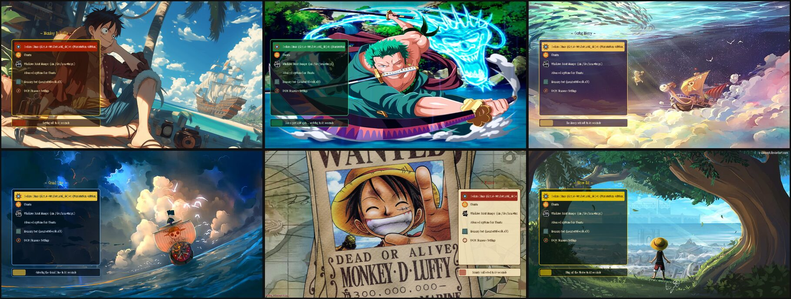

# One Piece GRUB Theme



A custom **One Piece themed GRUB bootloader** to spice up your system!
Six crew themes, hand-drawn distro icons and a setup command that adapts to
your distribution, screen and Windows dual-boot on its own.

*Türkçe kurulum için aşağıdaki [Türkçe](#-türkçe) bölümüne bakın.*

## ⚡ Quick start

```bash
git clone https://github.com/meowmet/one-piece-grub-theme.git
cd one-piece-grub-theme
sudo ./setup            # pick a theme from the menu
sudo ./setup zoro       # or name it directly
```

Reboot and set sail. After the first install the command works from anywhere:

```bash
sudo onepiece-setup sea        # switch theme
sudo onepiece-setup random     # surprise me
onepiece-setup list            # show all themes
onepiece-setup status          # what was detected / installed
sudo onepiece-setup remove     # uninstall and undo every change
```

Add `-y` to skip all questions (for scripts).

## 🏴‍☠️ Themes

Screenshots are taken from real GRUB running in QEMU.

| Command | Theme |
|---|---|
| `sudo ./setup luffy` | **Monkey D. Luffy** – *"Setting sail in 10 seconds"*<br> |
| `sudo ./setup zoro` | **Santoryu** – *"Zoro got lost again... arriving in 10 seconds"*<br> |
| `sudo ./setup goingmerry` | **Going Merry** – sailing over the clouds<br> |
| `sudo ./setup sea` | **Grand Line** – storm at sea<br> |
| `sudo ./setup wanted` | **Wanted** – bounty poster with a parchment menu<br> |
| `sudo ./setup straw-hat` | **Straw Hat** – the view from the tree<br> |

Aliases also work: `merry`, `strawhat`, `default`.

## 🤖 What `setup` does automatically

| Detects | And then |
|---|---|
| Distribution (`/etc/os-release`) | Uses `/boot/grub2` + `grub2-mkconfig` on Fedora/openSUSE, `/boot/grub` + `update-grub`/`grub-mkconfig` elsewhere |
| `/etc/default/grub.d` support (Debian, Ubuntu, Mint, Kali) | Writes its settings to `/etc/default/grub.d/zz-one-piece.cfg`, read last, so distro themes like Kali's cannot override it |
| Other distros (Fedora, Arch, openSUSE) | Appends one marked block to `/etc/default/grub` – existing lines are never edited |
| Screen resolution (`/sys/class/drm`) | Sets `GRUB_GFXMODE` to your native resolution (capped at 1920x1080 so text stays readable on 4K), unless you already set one |
| Windows (ESP or NTFS partition) | Enables os-prober and offers to install it with `dnf`/`apt`/`pacman`/`zypper` |
| Fedora's console terminal and hidden menu | Switches to the graphical terminal, clears `menu_auto_hide` |
| Ubuntu's hidden menu / timeout 0 | Shows the menu with a 10 second countdown |
| UEFI with an old full `grub.cfg` on the ESP | Regenerates that one too |
| systemd-boot / grub2-bls (Pop!_OS, new openSUSE) | Stops with an explanation instead of half-installing |
| NixOS | Prints the `configuration.nix` snippet |

`sudo onepiece-setup remove` deletes that file or block, so every setting goes
back to exactly what your distribution had.

## ✅ Compatibility

| System | Status |
|---|---|
| **Fedora** (BLS entries, BIOS + UEFI) | ✔ |
| **Ubuntu**, **Linux Mint**, **Debian**, **Kali**, Zorin, elementary | ✔ |
| **Arch Linux**, Manjaro, EndeavourOS, CachyOS, Garuda | ✔ |
| **openSUSE** with GRUB 2 | ✔ |
| CentOS, Rocky, Nobara | ✔ |
| **Windows dual-boot** | ✔ via os-prober |
| NixOS | ✔ `./setup build zoro ./one-piece-theme` + `boot.loader.grub.theme` |
| Pop!_OS, openSUSE with systemd-boot | ✘ not GRUB |

## 🧭 Icons

Every distro gets its own object from the One Piece world:

| | | | |
|---|---|---|---|
|  Fedora – ship's helm |  Ubuntu – Thousand Sunny |  EndeavourOS – Gomu Gomu no Mi |  Zorin – Zoro's swords |
|  Manjaro – Nami's tangerine |  openSUSE – Log Pose |  Pop!_OS – Chopper's hat |  elementary – Den Den Mushi |
|  Kubuntu – Franky's shades |  Nobara – Usopp's slingshot |  CachyOS – Clima-Tact |  Garuda – Marco's phoenix |
|  CentOS – anchor |  Rocky – treasure chest |  Memtest – Poneglyph |  Others – compass |

## 🪟 Windows dual-boot

`setup` enables os-prober and installs it when Windows is found. If Windows
still does not appear:

1. Make sure the Windows EFI partition is mounted (UEFI) or the Windows partition is readable.
2. Disable Windows *Fast Startup* so its partition is not locked.
3. Run `sudo onepiece-setup <theme>` again.

## 🛠️ Manual installation

```bash
./setup build zoro ./one-piece              # assemble the theme folder
sudo cp -r one-piece /boot/grub/themes/      # /boot/grub2/themes/ on Fedora/openSUSE
```

Then set `GRUB_THEME="/boot/grub/themes/one-piece/theme.txt"` in `/etc/default/grub` and run
`sudo update-grub` (Debian family), `sudo grub-mkconfig -o /boot/grub/grub.cfg` (Arch) or
`sudo grub2-mkconfig -o /boot/grub2/grub.cfg` (Fedora/openSUSE).

## 🎨 Making your own theme

Everything is generated by the scripts in `tools/` (Python 3 + Pillow):

```bash
python3 tools/make_icons.py          # icons/*.png
python3 tools/scale_font.py          # onepiece-24.pf2, onepiece-32.pf2
python3 tools/make_themes.py         # themes/<name>/
tools/grub-screenshot.sh zoro        # previews/zoro.jpg from real GRUB in QEMU
tests/test-setup.sh                  # setup tests on fake Fedora/Kali/Ubuntu
```

Add an entry to `THEMES` in `tools/make_themes.py` with a background from
`backgrounds/`, colours and a countdown message, run it, and install with
`sudo ./setup <name>`.

## 🇹🇷 Türkçe

```bash
git clone https://github.com/meowmet/one-piece-grub-theme.git
cd one-piece-grub-theme
sudo ./setup zoro
```

* `sudo ./setup` – menüden tema seç
* `sudo onepiece-setup sea` – kurulumdan sonra her yerden tema değiştir
* `onepiece-setup status` – algılanan sistemi ve kurulu temayı göster
* `sudo onepiece-setup remove` – temayı kaldır, tüm ayarları geri al

`setup` dağıtımını, ekran çözünürlüğünü ve Windows'u kendisi algılar; Fedora,
Ubuntu, Mint, Debian, Arch, openSUSE ve Kali'de ayarları ona göre yapar.
Windows varsa os-prober'ı kurar, menüde Windows görünür.

## ✨ Credits

Made by **Meowmet**

* One Piece © Eiichiro Oda / Shueisha / Toei Animation. This is a non-commercial fan project.
* Background artwork belongs to its original artists (e.g. `monkey_d_luffy.png` by
  s-concept on DeviantArt, `wanted.png` by drahl.com). If you are an artist and want
  credit added or an image removed, please open an issue.
* The ONE PIECE font belongs to its author.

> *If you have any recommendations, please mention them.* 🙌

## 📝 License

The code (`setup`, `tools/`, `tests/`) and the generated icons are licensed under
the MIT License – see the [LICENSE](LICENSE) file. The background images, the font
and the One Piece characters are not covered by this license.
