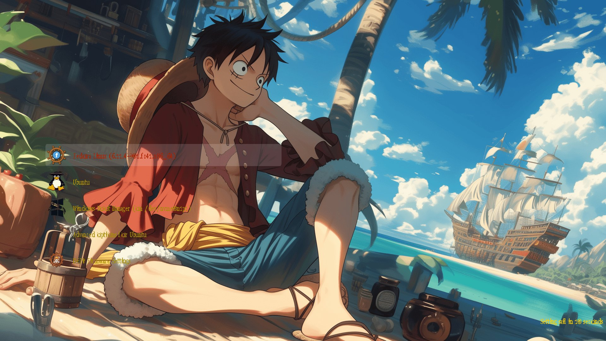
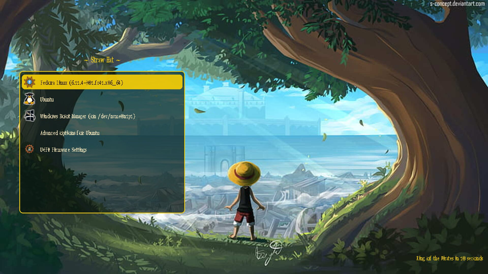

# One Piece GRUB Theme


A custom **One Piece themed GRUB bootloader** to spice up your system!

## ⚡ Quick start

```bash
git clone https://github.com/meowmet/one-piece-grub-theme.git
cd one-piece-grub-theme
sudo ./setup zoro
```

Pick a crew member, reboot, set sail. After the first install the command
works from anywhere:

```bash
sudo onepiece-setup sea        # switch theme
onepiece-setup list            # show all themes
sudo onepiece-setup remove     # uninstall
```

## 🏴‍☠️ Themes

| Command | Theme | Preview |
|---|---|---|
| `sudo ./setup luffy` | **Luffy** – the original theme |  |
| `sudo ./setup zoro` | **Santoryu** – green blades, *"Zoro got lost again..."* |  |
| `sudo ./setup goingmerry` | **Going Merry** – sailing over the clouds |  |
| `sudo ./setup sea` | **Grand Line** – storm at sea |  |
| `sudo ./setup wanted` | **Wanted** – bounty poster, parchment menu |  |
| `sudo ./setup straw-hat` | **Straw Hat** – the view from the tree |  |

Aliases also work: `merry`, `strawhat`, `default`.

## ✅ Compatibility

| System | Status | Notes |
|---|---|---|
| **Fedora** | ✔ | `/boot/grub2`, BLS entries, `GRUB_TERMINAL_OUTPUT="console"` fixed automatically |
| **Ubuntu** | ✔ | Hidden menu is switched to visible |
| **Linux Mint** | ✔ | |
| **Debian** | ✔ | |
| **Arch Linux** | ✔ | Also Manjaro, EndeavourOS |
| **openSUSE** | ✔ | `/boot/grub2` |
| **Windows (dual-boot)** | ✔ | Detected with `os-prober`, shown with the Windows icon |
| Kali, Zorin, elementary, CentOS, Rocky | ✔ | |
| NixOS | ✔ | `./setup build zoro ./one-piece-theme`, then `boot.loader.grub.theme` |
| Pop!_OS | ✘ | Uses systemd-boot by default, not GRUB |

Works with both **BIOS** and **UEFI** systems.

`setup` detects your distribution and:

* installs the theme to `/boot/grub/themes/one-piece` (or `/boot/grub2/themes/one-piece` on Fedora/openSUSE),
* sets `GRUB_THEME` in `/etc/default/grub` (a backup is saved next to it),
* enables the graphical terminal and a visible menu,
* enables `os-prober` so Windows shows up in the menu,
* regenerates `grub.cfg` with `update-grub`, `grub-mkconfig` or `grub2-mkconfig`.

## 🧭 Icons

Every distro gets its own object from the One Piece world:

| Icon | Distro | Icon | Distro |
|---|---|---|---|
|  | Fedora – ship's helm |  | EndeavourOS – Gomu Gomu no Mi |
|  | Zorin – Zoro's three swords |  | Manjaro – Nami's tangerine |
|  | openSUSE – Log Pose |  | Pop!_OS – Chopper's hat |
|  | elementary – Den Den Mushi |  | CentOS – anchor |
|  | Rocky – treasure chest |  | Fedora kernel entries – Jolly Roger |
|  | Other systems – compass | | |

## 🪟 Windows dual-boot

GRUB 2.06+ disables `os-prober` by default; `setup` turns it back on.
If Windows still does not appear:

1. Install os-prober:
   * Fedora: `sudo dnf install os-prober`
   * Ubuntu / Mint / Debian: `sudo apt install os-prober`
   * Arch / Manjaro: `sudo pacman -S os-prober`
   * openSUSE: `sudo zypper install os-prober`
2. Make sure the Windows EFI partition is mounted (UEFI) or the Windows partition is readable.
3. Disable Windows *Fast Startup* so its partition is not locked.
4. Run `sudo onepiece-setup <theme>` again.

## 🛠️ Manual installation

```bash
./setup build zoro ./one-piece             # assemble the theme folder
sudo cp -r one-piece /boot/grub/themes/     # /boot/grub2/themes/ on Fedora/openSUSE
```

In `/etc/default/grub`:

```bash
GRUB_THEME="/boot/grub/themes/one-piece/theme.txt"   # /boot/grub2/... on Fedora/openSUSE
GRUB_DISABLE_OS_PROBER=false
#GRUB_TERMINAL_OUTPUT="console"                     # comment out on Fedora
```

Then update GRUB:

* Debian / Ubuntu / Mint / Kali: `sudo update-grub`
* Arch / EndeavourOS: `sudo grub-mkconfig -o /boot/grub/grub.cfg`
* Fedora / openSUSE: `sudo grub2-mkconfig -o /boot/grub2/grub.cfg`

On Fedora also run `sudo grub2-editenv - unset menu_auto_hide` so the menu is not hidden.

## 🎨 Making your own theme

The themes, icons, larger font sizes and previews are generated by the scripts in `tools/`
(Python 3 + Pillow):

```bash
python3 tools/make_icons.py      # icons/*.png
python3 tools/scale_font.py      # onepiece-24.pf2, onepiece-32.pf2
python3 tools/make_themes.py     # themes/<name>/
python3 tools/preview.py         # previews/<name>.jpg
```

Add an entry to `THEMES` in `tools/make_themes.py` with a background from `backgrounds/`,
colours and a timeout message, run it, and install with `sudo ./setup <name>`.

## ✨ Credits

Made by **Meowmet**

> *If you have any recommendations, please mention them.* 🙌


## 📝 License

This project is licensed under the MIT License – see the [LICENSE](LICENSE) file for details.
